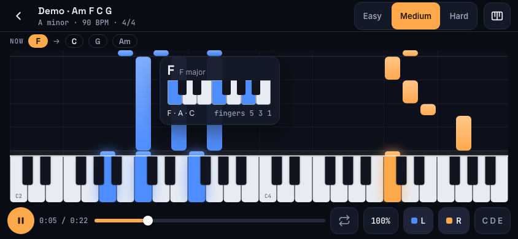
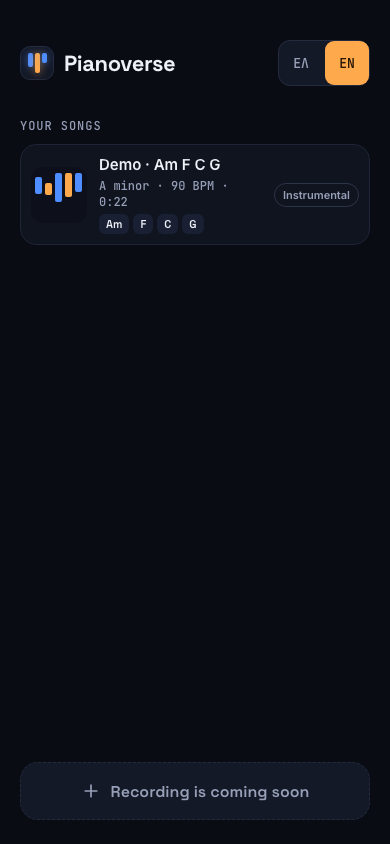

# Pianoverse

**Record a song, get it back as piano — and learn to play it.**

Pianoverse listens to any song (vocals, a band, or solo piano), writes a playable piano arrangement at three difficulty levels, and teaches it with falling notes, a lit-up keyboard and the chords as you go. In Greek and English.

<p align="center">
  
</p>

## What it does

- **Song → piano.** Separates the instruments, finds the beat, the chords and the melody, and arranges them for two hands:
  - **Easy:** melody + one bass note per chord
  - **Medium:** melody + chords in the left hand
  - **Hard:** melody with harmony + arpeggios
  - **Original:** the faithful transcription, for solo-piano recordings
- **Learn it.** Falling notes and a keyboard that lights up, chord names as they come, a chord card with the keys and fingering, A–B loop, 25–100% speed, hands on/off (switch one hand off and the app plays it while you play the other), note names in your language (Ντο Ρε Μι / C D E).
- **Greek and English** throughout.

<p align="center">
  
</p>

## Status

| Step | |
|---|---|
| Arrangement engine (Python CLI) | ✅ |
| Visual design | ✅ "Stage" direction ([spec §6](docs/superpowers/specs/2026-11-07-pianoverse-design.md#6-οπτικός-σχεδιασμός)) |
| Web player on local songs | ✅ |
| Backend (FastAPI on Modal + Supabase) | ✅ local · cloud next |
| Record / upload in the app | ✅ local |
| iOS & Android (Capacitor) | planned |

Known gap: chords from phone/laptop-microphone recordings are still weak; clean audio files work well. See [docs/HANDOVER.md](docs/HANDOVER.md) for details and next steps.

## How it works

```
audio ─► ffmpeg (normalize)
      ─► Demucs (vocals / drums / bass / piano / guitar / other)
      ─► beat_this (beats, tempo)           ┐
      ─► BTC (chords, large vocabulary)     ├─► arranger ─► Song JSON + MIDI ─► player
      ─► Basic Pitch / ByteDance (melody)   ┘
```

The player is a React app: a canvas piano roll driven by its own transport clock, and a sampled piano (Tone.js) scheduled from the same clock.

## Repository

| Path | |
|---|---|
| [`engine/`](engine/) | Python engine and CLI (`pianoverse-engine song.mp3 --out out/song`) |
| [`app/`](app/) | React + Vite + TypeScript player |
| [`schema/`](schema/) | Song JSON schema shared by both |
| [`docs/`](docs/) | Design spec, implementation plans, handover |

## Quick start

Requirements: macOS or Linux, Node ≥ 22.22, [pnpm](https://pnpm.io), [uv](https://docs.astral.sh/uv/), ffmpeg and wget (`brew install ffmpeg wget uv pnpm`).

**Run the whole app (server + web app) with one command:**

```bash
./dev.sh
```

It checks the tools, installs what's missing, creates an API key in `app/.env.local` the first time, starts the engine's server and the web app on a free port, and opens the browser. Ctrl+C stops both. Then record a song, choose an audio file, or drag one anywhere onto the page.

**Only the player with the demo song (no server):**

```bash
cd app
pnpm install
pnpm dev
```

**Turn your own song into piano:**

```bash
cd engine
uv sync
uv run pianoverse-engine path/to/song.mp3 --out out/my-song
```

The first run downloads the models (~300 MB). To open the result in the player, see [app/README.md](app/README.md#your-own-songs).

**Tests:**

```bash
cd engine && uv run pytest              # add -m slow for the real models
cd app && pnpm test && pnpm test:e2e
```

## Docs

- [Design spec](docs/superpowers/specs/2026-11-07-pianoverse-design.md) — decisions, architecture, spike results
- [Engine plan](docs/superpowers/plans/2026-11-07-engine-spike.md) · [Player plan](docs/superpowers/plans/2026-11-07-player.md)
- [Handover](docs/HANDOVER.md) — where things stand and what's next

## Ελληνικά

Το Pianoverse ακούει ένα τραγούδι, βγάζει διασκευή για πιάνο σε τρία επίπεδα (εύκολο, μέτριο, δύσκολο) και σου τη διδάσκει με νότες που πέφτουν, πληκτρολόγιο που φωτίζεται και συγχορδίες. Η εφαρμογή είναι στα ελληνικά και στα αγγλικά. Για να συνεχίσεις την ανάπτυξη, ξεκίνα από το [docs/HANDOVER.md](docs/HANDOVER.md).

## Credits

Built on [Demucs](https://github.com/facebookresearch/demucs), [beat_this](https://github.com/CPJKU/beat_this), [Basic Pitch](https://github.com/spotify/basic-pitch), [piano_transcription_inference](https://github.com/qiuqiangkong/piano_transcription_inference), [BTC](https://github.com/jayg996/BTC-ISMIR19) (vendored under its MIT license in `engine/src/pianoverse_engine/vendor/btc/`), [librosa](https://librosa.org), [Tone.js](https://tonejs.github.io) and its Salamander Grand Piano samples. See each project for its license.
